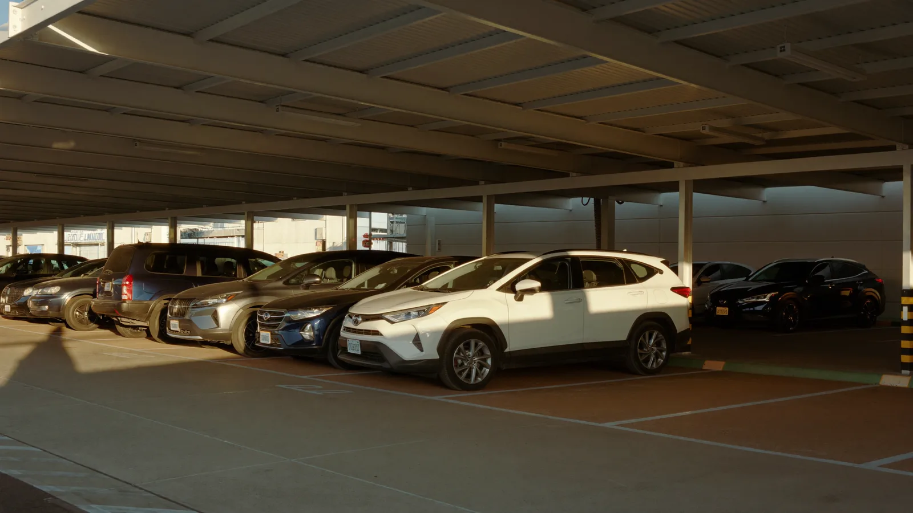

# Estacionamento aeroporto Viracopos nas férias: quanto custa e como se planejar

Quem mora em Campinas e região e vai viajar nas férias de fim de ano tem no estacionamento do aeroporto de Viracopos uma das contas a fechar antes de embarcar. Na Virapark, a 3,7 km do terminal, a vaga coberta sai a partir de R$ 40,00 a diária e R$ 174,30 por 7 diárias, em preços consultados em 13 de outubro de 2026, com van gratuita até o embarque a cada 15 minutos. Veja quanto custa cada período e como encaixar o estacionamento no horário do voo.

## Quanto custa o estacionamento no aeroporto de Viracopos nas férias?

A Virapark, estacionamento perto do aeroporto de Viracopos na Antiga Rodovia Santos Dumont, km 64, em Campinas, cobrava na vaga coberta a partir de R$ 40,00 a diária avulsa em 13 de outubro de 2026. Em viagens de uma semana ou mais, o dia cai para R$ 24,90.

| Período | Vaga coberta | Custo por dia |
|---|---|---|
| 1 diária | R$ 40,00 | R$ 40,00 |
| 7 diárias | R$ 174,30 | R$ 24,90 |
| 15 diárias | R$ 373,50 | R$ 24,90 |
| 30 diárias | R$ 747,00 | R$ 24,90 |

Fonte: Virapark, preços consultados na Movepark em 13/10/2026.

Os valores mudam conforme a data, e dezembro e janeiro concentram a saída de férias em Viracopos. Simule com as datas exatas da viagem antes de fechar a conta. Para ver a Virapark ao lado de outros estacionamentos parceiros da região, com preço e distância do terminal, compare os [estacionamentos perto do aeroporto de Viracopos](https://movepark.co/estacionamentos/aeroporto-viracopos) na Movepark.

## Quanto tempo antes sair de casa para pegar o voo em Viracopos?

Para voo nacional, as companhias aéreas recomendam chegar ao terminal de Viracopos duas horas antes da partida. Para voo internacional, três horas. A esse prazo some o trajeto da sua casa até o estacionamento e o tempo da van, que na Virapark sai a cada 15 minutos.

No fim de ano, conte também o trânsito de saída de férias nas rodovias da região de Campinas. Um voo de sábado de manhã em dezembro pede mais folga do que o mesmo voo numa terça de outubro.

### Exemplo para um voo nacional às 10h

- **6h30 ou antes:** saída de casa, se você mora do outro lado de Campinas ou numa cidade vizinha.
- **7h15:** chegada à Virapark, com margem para a espera da van e para os 3,7 km até o embarque.
- **8h:** você no terminal, duas horas antes do voo.

## Como funciona a van do estacionamento Virapark até o aeroporto de Viracopos?

A Virapark tem traslado gratuito até o terminal de Viracopos, com van a cada 15 minutos, e funciona 24 horas. O estacionamento declara câmeras 24 horas, portão com controle de acesso, sala de espera com wi-fi, banheiro e acessibilidade para pessoa com deficiência.

Antes de embarcar na ida, confirme com a Virapark como funciona o encontro com a van na volta e salve o contato no celular. É a primeira coisa que você vai procurar quando o avião pousar.

## Estacionamento aeroporto Viracopos: o que conferir antes de reservar nas férias de fim de ano?

As férias de dezembro e janeiro concentram viagens longas, com família e bagagem. Alguns detalhes resolvidos antes evitam correria no dia.

### Datas e horários

- Conte as diárias até o dia e o horário do pouso na volta.
- Guarde a tolerância de 60 minutos que a Virapark declara na saída, útil quando a esteira de bagagem demora.
- Confira se o voo é nacional ou internacional para calcular a antecedência certa.

### Carro e bagagem

- Deixe combustível para a volta e nenhum objeto de valor à vista.
- Separe antes a bagagem que vai na van, para não abrir o porta-malas duas vezes.
- Se viaja com criança, deixe a cadeirinha no carro e leve o necessário para o terminal.

### Reserva

A reserva da vaga pode ser feita no site da [Virapark](https://www.virapark.com.br/), com as datas da ida e da volta. Fazer isso antes de dezembro tira o estacionamento da lista de pendências da semana da viagem.

## Perguntas frequentes sobre estacionamento aeroporto Viracopos

### Quanto custa o estacionamento no aeroporto de Viracopos por 15 dias?

Na Virapark, 15 diárias em vaga coberta saíam a partir de R$ 373,50 em 13 de outubro de 2026, o que dá R$ 24,90 por dia. O valor muda com a data da viagem, então simule com o período exato antes de reservar.

### O estacionamento Virapark fica dentro do aeroporto de Viracopos?

A Virapark fica fora do aeroporto, na Antiga Rodovia Santos Dumont, km 64, Jardim Santa Maria II, em Campinas, a 3,7 km do terminal em linha reta. O trajeto até o embarque é feito na van gratuita, que sai a cada 15 minutos.

### O estacionamento perto do aeroporto de Viracopos abre de madrugada?

A Virapark funciona 24 horas, o que atende voo que sai cedo e voo que volta de madrugada. Na reserva, confira como funciona a van no horário em que o seu voo chega.
