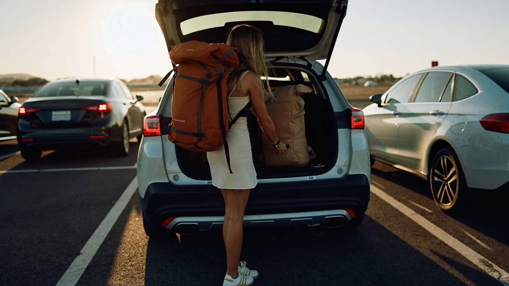

# Estacionamento aeroporto Guarulhos para mochilão: quanto custa deixar o carro 30 dias

Quem sai de mochilão pelo aeroporto de Guarulhos e mora longe do terminal acaba pensando em ir de carro, e a dúvida é se o estacionamento no aeroporto de Guarulhos cabe no orçamento de uma viagem longa. Em outubro de 2026, 30 diárias em vaga descoberta saíam a partir de R$ 239,40 nos estacionamentos parceiros da Movepark, menos de R$ 8 por dia. Aqui vai a conta completa, com o que comparar antes de decidir entre carro e aplicativo.

## Estacionamento aeroporto Guarulhos: quanto custa deixar o carro 15 ou 30 dias?

No estacionamento do aeroporto de Guarulhos, entre os parceiros da Movepark, a vaga descoberta custava a partir de R$ 152,70 por 15 diárias e R$ 239,40 por 30 diárias em 13 de outubro de 2026. Quanto mais longa a viagem, menor o custo de cada dia: a diária avulsa sai a partir de R$ 18,49, e no período de 30 dias o dia cai para R$ 7,98.

| Período | Vaga descoberta | Custo por dia |
|---|---|---|
| 7 diárias | R$ 93,17 | R$ 13,31 |
| 15 diárias | R$ 152,70 | R$ 10,18 |
| 30 diárias | R$ 239,40 | R$ 7,98 |

Fonte: estacionamentos parceiros da Movepark em Guarulhos, preços consultados em 13/10/2026.

O comparativo de cada estacionamento, com distância do terminal, tipo de vaga e van, fica em [estacionamento aeroporto Guarulhos](https://movepark.co/estacionamentos/aeroporto-guarulhos), na Movepark.

## Estacionamento no aeroporto de Guarulhos ou aplicativo: o que vale mais a pena?

A conta é simples: some o preço da corrida de aplicativo de ida e de volta entre a sua casa e o terminal de Guarulhos, e compare com o estacionamento pelo número de dias da viagem. Num mochilão de 30 dias, o estacionamento sai a partir de R$ 239,40. Se as duas corridas somarem mais do que isso, o carro ganha.

Em viagem curta a conta pode virar, porque a diária avulsa pesa mais. E tem o que não entra na planilha: voltar de um mochilão depois de um voo longo, com a mochila pesada e o corpo em outro fuso, e encontrar o carro esperando a poucos minutos do terminal.

## Como economizar no estacionamento do aeroporto de Guarulhos?

Dá para economizar sem abrir mão da van até o terminal. As dicas abaixo resumem o guia de [como estacionar barato no aeroporto de Guarulhos](https://movepark.co/blog/como-estacionar-barato-no-aeroporto-de-guarulhos/):

- **Escolha a vaga descoberta.** Em 30 dias, a diferença para a coberta foi de R$ 48,00 na consulta de outubro de 2026.
- **Reserve pelo período exato.** Conte as diárias até o dia e o horário do pouso na volta, porque cada diária a mais pesa no total.
- **Confira a estadia mínima.** O Aeropark, a 2,7 km do terminal, pede no mínimo 2 diárias.
- **Use a tolerância a seu favor.** Os parceiros da Movepark em Guarulhos declaram tolerância de 60 minutos na saída, o que ajuda quando a esteira de bagagem demora.
- **Compare antes de fechar.** O preço muda entre estacionamentos e entre datas, e num mês inteiro qualquer diferença por dia vira dinheiro de verdade.

## O que fazer antes de deixar o carro 30 dias parado?

Carro parado um mês pede cuidado de quem sai para longe. São cinco minutos de checklist que evitam dor de cabeça na volta.

### No carro

- Deixe combustível suficiente para a volta, porque ninguém quer procurar posto depois de um voo noturno.
- Tire do carro documentos, eletrônicos e qualquer objeto à vista.
- Se a bateria já deu sinal de fraqueza, confira antes de sair, porque 30 dias parado pesam numa bateria fraca.
- Fotografe a vaga ou anote o setor onde o carro ficou.

### Na mochila

- Comprovante da reserva salvo no celular, também em modo offline.
- Contato do estacionamento e a explicação de como encontrar a van na volta.

## Perguntas frequentes sobre estacionamento aeroporto Guarulhos

### Quanto custa o estacionamento no aeroporto de Guarulhos por 30 dias?

Em 13 de outubro de 2026, 30 diárias em estacionamento parceiro da Movepark em Guarulhos saíam a partir de R$ 239,40 na vaga descoberta e R$ 287,40 na coberta. Na descoberta isso dá menos de R$ 8 por dia, e o valor varia com a data da viagem.

### O estacionamento no aeroporto de Guarulhos leva até o terminal?

O Aeropark, a 2,7 km do terminal em linha reta, tem van gratuita com trajeto de cerca de 10 minutos e saída a cada 30 minutos. Nem todo estacionamento da região tem van, então confira esse item na ficha antes de reservar.

### Posso deixar a mochila ou outros objetos no carro?

Leve tudo o que tem valor e deixe o carro sem nada à vista, mesmo em estacionamento com câmeras 24 horas e controle de acesso. Um mês é tempo demais para arriscar, e o que não vai na viagem pode ficar em casa.
