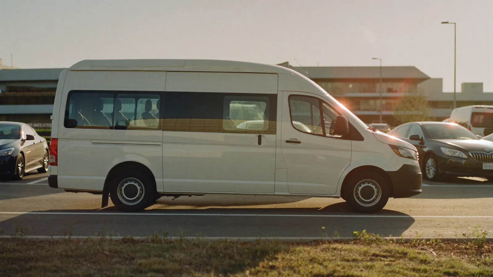

# Estacionamento aeroporto Viracopos: checklist para ir de carro e embarcar sem correria

Ir de carro até Viracopos e usar um estacionamento no aeroporto de Viracopos com van até o terminal funciona bem quando a ida tem roteiro: sair na hora certa, saber onde estacionar e deixar a volta resolvida. Este checklist reúne o que conferir em cada etapa, com os preços da Virapark, que fica a 3,7 km do terminal e cobrava a partir de R$ 174,30 por 7 diárias em vaga coberta na consulta de 13 de outubro de 2026.

## Antes de sair de casa: o que deixar pronto?

Deixe estes itens resolvidos na véspera, e a manhã do voo fica só para sair de casa.

### Reserva e horários

- Reserva do estacionamento salva no celular, com as datas de ida e de volta.
- Horário de chegada ao terminal: duas horas antes para voo nacional e três para internacional, como recomendam as companhias aéreas.
- Margem para a van, que na Virapark sai a cada 15 minutos.

### Documentos e bagagem

- Documento com foto e cartão de embarque no celular.
- Mala de mão separada do que fica no carro.
- Carregador e um casaco leve à mão, porque a sala de embarque costuma ter ar-condicionado forte.

## Quanto custa o estacionamento no aeroporto de Viracopos durante a viagem?

Estacionamento aeroporto Viracopos na Virapark: a vaga coberta custava a partir de R$ 174,30 por 7 diárias, R$ 373,50 por 15 e R$ 747,00 por 30 em 13 de outubro de 2026. Nesses três períodos o custo fica em R$ 24,90 por dia, e a diária avulsa sai a partir de R$ 40,00.

| Duração da viagem | Vaga coberta na Virapark |
|---|---|
| 1 semana (7 diárias) | R$ 174,30 |
| 15 dias | R$ 373,50 |
| 1 mês (30 diárias) | R$ 747,00 |

Fonte: Virapark, preços consultados na Movepark em 13/10/2026. Os valores mudam conforme a data da viagem.

## Na estrada: como chegar ao estacionamento perto do aeroporto de Viracopos?

A Virapark fica na Antiga Rodovia Santos Dumont, km 64, no Jardim Santa Maria II, em Campinas. Coloque o endereço no aplicativo de mapas antes de sair, e não o do aeroporto, para não passar direto pela entrada do estacionamento.

Em dia de saída de férias, confira o trânsito antes de sair de casa. Dez minutos de folga na estrada valem mais do que dez minutos a mais de sono.

## Como funciona a van do estacionamento até o aeroporto de Viracopos?

Na Virapark você mesmo estaciona o carro na vaga e segue para a van gratuita, que sai a cada 15 minutos rumo ao terminal de Viracopos. O estacionamento funciona 24 horas e declara câmeras 24 horas, portão com controle de acesso, sala de espera com wi-fi, banheiro e acessibilidade para pessoa com deficiência.

### Checklist na hora de estacionar

- Fotografe a vaga ou anote onde o carro ficou.
- Tire do carro os objetos de valor e não deixe nada à vista.
- Confira se a mala e a mochila foram com você para a van.

## Na volta: o que fazer ao pousar em Viracopos?

A volta começa na ida: antes de embarcar, confirme com a Virapark como funciona o encontro com a van no desembarque e salve o contato no celular. Assim, ao sair da área de bagagem, você já sabe para onde ir. A Virapark declara tolerância de 60 minutos na saída, o que ajuda quando a mala demora na esteira.

## Onde comparar os estacionamentos do aeroporto de Viracopos?

Para ver a Virapark ao lado de outros estacionamentos parceiros do aeroporto de Viracopos, com preço, distância do terminal e informação da van, use a [Movepark](https://movepark.co/estacionamentos/aeroporto-viracopos). A reserva da Virapark também pode ser feita direto no site da [Virapark](https://www.virapark.com.br/).

## Perguntas frequentes sobre estacionamento aeroporto Viracopos

### Quanto custa o estacionamento no aeroporto de Viracopos por uma semana?

Na Virapark, 7 diárias em vaga coberta saíam a partir de R$ 174,30 em 13 de outubro de 2026, o que dá R$ 24,90 por dia. O valor muda com a data da viagem, então simule com o período exato antes de reservar.

### Preciso entregar a chave do carro no estacionamento?

Na Virapark você mesmo estaciona o carro na vaga, sem manobrista. Depois é só seguir para a van gratuita, que sai a cada 15 minutos até o terminal de Viracopos.

### Tem onde esperar a van no estacionamento do aeroporto de Viracopos?

A Virapark declara sala de espera com wi-fi e banheiro, além de acessibilidade para pessoa com deficiência. Com van a cada 15 minutos, a espera costuma ser curta, e dá para conferir o voo enquanto ela chega.
