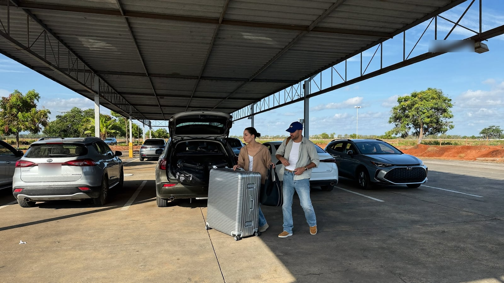
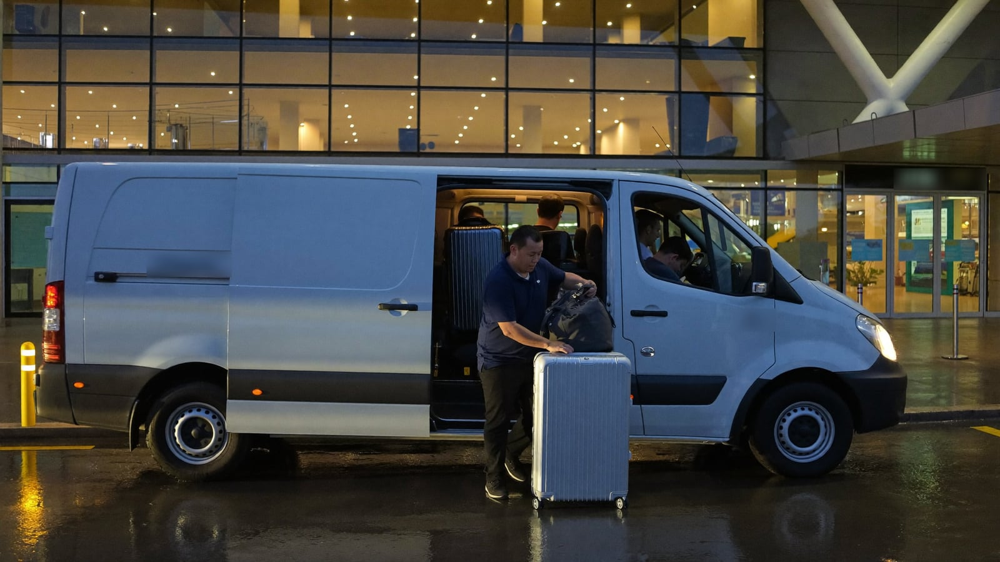

# Estacionamento em Viracopos para viagem longa: quanto custa deixar o carro 10, 15 ou 30 dias

Viagem internacional ou férias de mais de uma semana mudam a conta do estacionamento em Viracopos para viagem longa: o que pesa deixa de ser a diária e passa a ser o total. Na Virapark, a 3,7 km do terminal, a vaga coberta sai por R$ 299,00 em 10 diárias e R$ 897,00 em 30 diárias, em preços consultados em 10 de novembro de 2026, com van gratuita até o embarque a cada 15 minutos.

## Quanto custa deixar o carro em Viracopos por 10, 15 ou 30 dias?

Na Virapark, estacionamento perto do aeroporto de Viracopos na Antiga Rodovia Santos Dumont, km 64, em Campinas, a vaga coberta custava R$ 40,00 a diária avulsa em 10 de novembro de 2026. A partir de 7 diárias, o dia cai para R$ 29,90, e é nessa faixa que fica toda viagem longa.

| Período | Vaga coberta na Virapark | Custo por dia |
|---|---|---|
| 7 diárias | R$ 209,30 | R$ 29,90 |
| 10 diárias | R$ 299,00 | R$ 29,90 |
| 15 diárias | R$ 448,50 | R$ 29,90 |
| 21 diárias | R$ 627,90 | R$ 29,90 |
| 30 diárias | R$ 897,00 | R$ 29,90 |

Fonte: Virapark, preços consultados na Movepark em 10/11/2026.

Os valores podem mudar até a data da sua reserva, e dezembro e janeiro concentram as saídas de férias em Viracopos. Simule com as datas exatas antes de fechar a conta.

## E o estacionamento dentro do aeroporto de Viracopos, quanto sai?

No estacionamento oficial do aeroporto de Viracopos, a tabela publicada no site do aeroporto em 10 de novembro de 2026 cobrava R$ 83,00 a diária no edifício garagem e R$ 31,00 a diária no bolsão econômico F. A tabela do edifício garagem vai até 10 diárias, por R$ 830,00, e não publica o valor de estadias maiores.

| Período | Edifício garagem | Bolsão F | Virapark (coberta) |
|---|---|---|---|
| 10 diárias | R$ 830,00 | R$ 310,00 | R$ 299,00 |
| 15 diárias | não publicado | R$ 465,00 | R$ 448,50 |
| 30 diárias | não publicado | R$ 930,00 | R$ 897,00 |

Fonte: site do aeroporto de Viracopos e Virapark na Movepark, consultados em 10/11/2026. O bolsão F foi calculado pela diária de R$ 31,00.

Em viagem longa, a diferença para o edifício garagem passa de R$ 500,00 já em 10 dias. O bolsão econômico fica perto da Virapark no preço, mas é descoberto. Para comparar a Virapark com outros estacionamentos parceiros da região, com preço e distância do terminal lado a lado, a [Movepark](https://movepark.co/estacionamentos/aeroporto-viracopos) mostra o total de cada opção para as datas da viagem.

## Vale pagar por vaga coberta numa viagem de duas semanas?

Numa viagem de duas semanas ou mais, a vaga coberta costuma compensar. O carro fica parado ao sol de Campinas por dias seguidos, e no verão a região tem chuva forte quase todo fim de tarde. Pintura, borracha e painel sentem mais em 15 dias descobertos do que em um fim de semana.

Na conta acima, a vaga coberta da Virapark em 15 diárias custa R$ 16,50 a menos que o bolsão F descoberto do aeroporto. Ou seja, nessa duração a cobertura não sai mais cara.

## Como funciona a van até o terminal de Viracopos?

A Virapark tem traslado gratuito até o terminal de Viracopos, com van a cada 15 minutos, e funciona 24 horas. O estacionamento declara câmeras 24 horas, portão com controle de acesso, sala de espera com wi-fi, banheiro e acessibilidade para pessoa com deficiência.

Na volta de uma viagem internacional, o desembarque demora mais por causa da imigração e da alfândega. Combine com a Virapark o encontro com a van antes de embarcar na ida e salve o contato no celular, porque é a primeira coisa que você vai procurar depois de pegar a bagagem.

## Quanto tempo antes sair de casa para um voo internacional em Viracopos?

Para voo internacional, as companhias aéreas recomendam chegar ao terminal três horas antes da partida. A esse prazo some o trajeto da sua casa até o estacionamento e alguns minutos para a van, que na Virapark sai a cada 15 minutos.

### Exemplo para um voo internacional às 22h

- **17h30:** saída de casa, se você mora em Campinas ou numa cidade vizinha.
- **18h15:** chegada à Virapark, com margem para estacionar, tirar as malas e esperar a van.
- **19h:** você no terminal, três horas antes do voo.

Em dezembro e janeiro, conte também o trânsito de saída de férias nas rodovias da região. Uma sexta-feira de férias pede mais folga que uma terça de novembro.

## O que deixar resolvido antes de viajar por muitos dias?

Viagem longa tem detalhes que não pesam num bate e volta. Resolva estes antes de sair de casa.

### Carro

- Combustível suficiente para a volta, que costuma ser depois de um voo longo e cansativo.
- Nenhum objeto de valor à vista dentro do carro.
- Bateria em dia: carro parado por três semanas ou mais pode ter dificuldade de partida, principalmente se a bateria já é antiga.
- Fotos do carro pelos quatro lados e do painel, feitas no estacionamento.

### Datas e horários

- Conte as diárias até o dia e o horário em que você estima pegar o carro, e não só o horário do pouso.
- Guarde a tolerância de 60 minutos que a Virapark declara na saída, útil quando a fila da imigração demora.

### Reserva

A reserva da vaga pode ser feita no site da [Virapark](https://www.virapark.com.br/), com as datas da ida e da volta. Fazer isso com antecedência tira o estacionamento da lista de pendências da semana da viagem.

## Perguntas frequentes sobre estacionamento em Viracopos para viagem longa

### Quanto custa deixar o carro 15 dias em Viracopos?

Na Virapark, 15 diárias em vaga coberta custavam R$ 448,50 em 10 de novembro de 2026, ou R$ 29,90 por dia. No bolsão F do aeroporto, descoberto, a mesma estadia somaria R$ 465,00 pela diária de R$ 31,00. O edifício garagem não publica valor para 15 dias.

### Quanto custa deixar o carro um mês em Viracopos?

Na Virapark, 30 diárias em vaga coberta custavam R$ 897,00 em 10 de novembro de 2026. No bolsão F do aeroporto, 30 diárias somariam R$ 930,00. Os valores mudam com a data da reserva, então simule com o período exato.

### A Virapark funciona de madrugada para quem volta de voo internacional?

A Virapark funciona 24 horas, com van a cada 15 minutos. Isso atende quem pousa de madrugada depois de um voo internacional. Combine o encontro com a van antes da ida e salve o contato do estacionamento no celular.
